# 🗺️ نقشه تفکر سیستمی جامع — agentmemory v0.9.29
## تمام قابلیت‌ها × تمام ابزارها × تمام لایه‌ها

> **شعار**: هیچ فایل، ماژول، قابلیت، ابزار، یا Integration از قلم نیفتاده
>
> **Inventory کامل**:
> 65 Function · 54 MCP Tool · 6 MCP Resource · 3 MCP Prompt ·
> 130 REST Endpoint · 15 Hook · 7 LLM Provider · 7 Embedding Provider ·
> 13 State Module · 28 CLI Connect Agent · 4 Integration ·
> 17 Plugin Skill · 14 Superpowers Skill · 6 Custom Subagent ·
> 5 Eval Module · 7 Prompt Template · 4 Deploy Target · 5 Benchmark ·
> Viewer Dashboard · Fable 5.1 Orchestrator ·
> Graphify · Headroom · Codeburn · 1,596+ Tests

---

## فهرست ۱۵ لایه معماری

| # | لایه | فایل‌ها | بخش |
|---|------|---------|------|
| 1 | [Entry Points](#1-entry-points) | 3 | §1 |
| 2 | [MCP Server](#2-mcp-server) | 6 | §2 |
| 3 | [REST API / Triggers](#3-rest-api) | 2 | §3 |
| 4 | [Core Functions](#4-core-functions) | 65 | §4 |
| 5 | [State Layer](#5-state-layer) | 13 | §5 |
| 6 | [LLM Providers](#6-llm-providers) | 11 | §6 |
| 7 | [Embedding Providers](#7-embedding-providers) | 9 | §7 |
| 8 | [Lifecycle Hooks](#8-hooks) | 15 | §8 |
| 9 | [CLI & Connect](#9-cli) | 38 | §9 |
| 10 | [Prompt Templates](#10-prompts) | 7 | §10 |
| 11 | [Eval / Quality](#11-eval) | 5 | §11 |
| 12 | [Viewer Dashboard](#12-viewer) | 4 | §12 |
| 13 | [Replay & Health & Telemetry](#13-replay-health) | 5 | §13 |
| 14 | [Plugin Ecosystem](#14-plugins) | 50+ | §14 |
| 15 | [Deploy & Benchmark & Docs](#15-deploy) | 20+ | §15 |

**ابزارهای خارجی**: [Antigravity IDE](#16-antigravity) · [Fable 5.1](#17-fable) · [Superpowers](#18-superpowers) · [Graphify](#19-graphify) · [Headroom](#20-headroom) · [Codeburn](#21-codeburn)

---

## 1. Entry Points — نقاط ورود

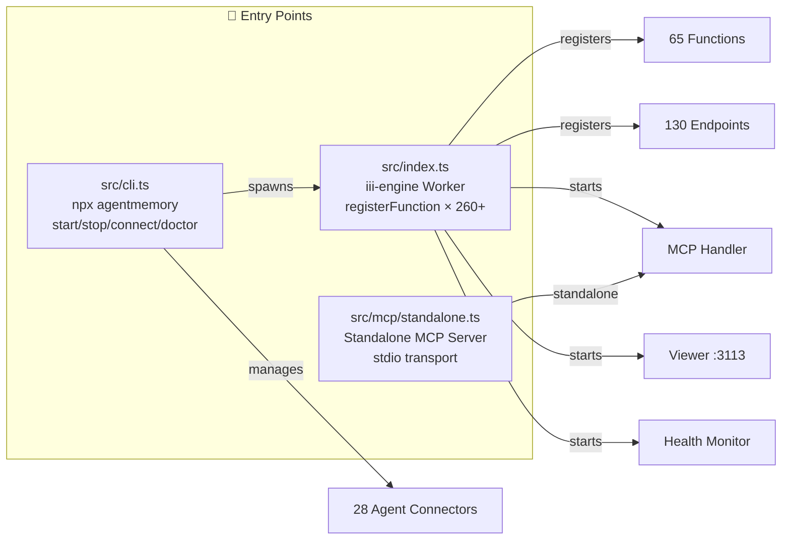

| فایل | نقش | Subagent |
|------|------|----------|
| `src/index.ts` | Worker اصلی — ثبت تمام فانکشن‌ها + تریگرها | @memory-architect |
| `src/cli.ts` | CLI: start/stop/connect/doctor/remove | @consistency-guardian |
| `src/mcp/standalone.ts` | MCP Server مستقل (stdio) | @mcp-tool-builder |
| `src/config.ts` | Configuration loader + env detection | @memory-architect |
| `src/auth.ts` | Authentication (checkAuth) | @api-endpoint-builder |
| `src/logger.ts` | Structured logging | @consistency-guardian |
| `src/types.ts` | تمام Type definitions | @memory-architect |
| `src/version.ts` | `VERSION = "0.9.29"` | @consistency-guardian |
| `src/runtime-paths.ts` | Path resolution | @consistency-guardian |
| `src/cli-data-dir.ts` | Data directory management | @consistency-guardian |

---

## 2. MCP Server — پروتکل ارتباط مدل

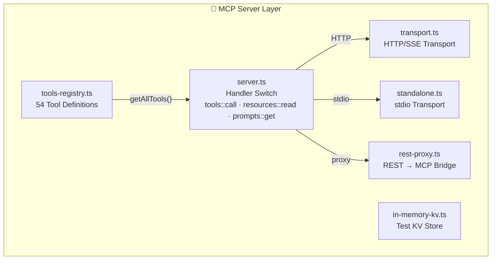

| قابلیت | تعداد | فایل |
|--------|-------|------|
| MCP Tools | 54 (8 visible default, 54 with `AGENTMEMORY_TOOLS=all`) | `tools-registry.ts` |
| MCP Resources | 6 | `server.ts` (resources::read) |
| MCP Prompts | 3 | `server.ts` (prompts::get) |
| Transport HTTP/SSE | 1 | `transport.ts` |
| Transport stdio | 1 | `standalone.ts` |
| REST Proxy | 1 | `rest-proxy.ts` |
| Test KV | 1 | `in-memory-kv.ts` |

---

## 3. REST API / Triggers

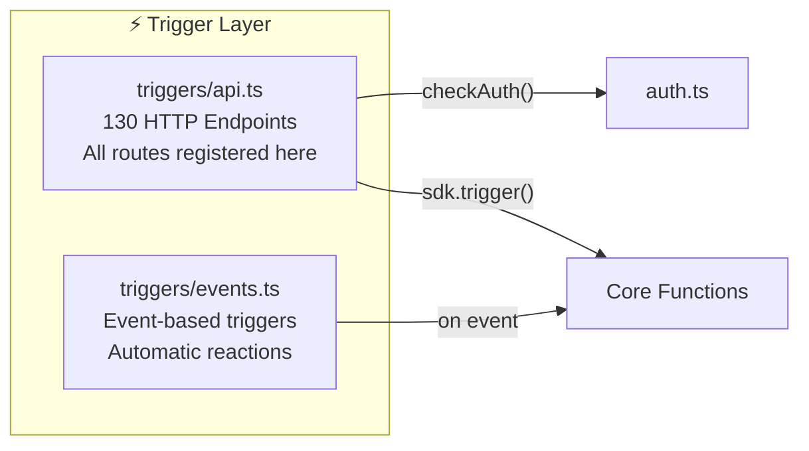

| Pattern | Detail |
|---------|--------|
| Auth | `checkAuth(req, secret)` — **هر endpoint** |
| Body | Whitelist fields — **هرگز raw body** |
| Route | `/agentmemory/{path}` |
| Method | POST (mutations), GET (reads) |

---

## 4. Core Functions — ۶۵ فانکشن در ۸ دامنه

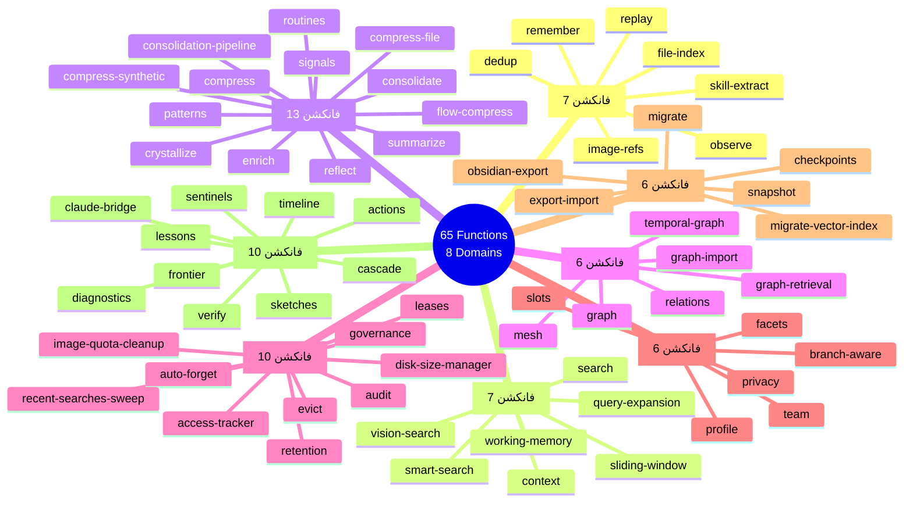

### جدول کامل ۶۵ فانکشن

| # | فانکشن | دامنه | iii-prefix | وظیفه | Subagent | AGY Tool |
|---|--------|-------|-----------|-------|----------|----------|
| 1 | `observe` | Ingestion | `mem::observe` | ثبت مشاهدات ایجنت | @memory-architect | Direct |
| 2 | `remember` | Ingestion | `mem::remember` | ذخیره صریح خاطره | @memory-architect | Direct |
| 3 | `dedup` | Ingestion | `mem::dedup` | حذف تکراری‌ها (fingerprintId) | @memory-architect | Direct |
| 4 | `file-index` | Ingestion | `mem::file-index` | ایندکس فایل‌ها | @memory-architect | Direct |
| 5 | `image-refs` | Ingestion | `mem::image-refs` | مدیریت ارجاع تصاویر | @memory-architect | Direct |
| 6 | `skill-extract` | Ingestion | `mem::skill-extract` | استخراج مهارت از مکالمات | @memory-architect | `/boost` |
| 7 | `replay` | Ingestion | `mem::replay` | بازپخش سشن‌ها | @memory-architect | Direct |
| 8 | `search` | Retrieval | `mem::search` | جستجوی Hybrid (BM25+Vector) | @memory-architect | `/boost` |
| 9 | `smart-search` | Retrieval | `mem::smart-search` | جستجو + Graph fusion | @memory-architect | `/boost` |
| 10 | `query-expansion` | Retrieval | `mem::query-expand` | گسترش خودکار کوئری | @memory-architect | Direct |
| 11 | `context` | Retrieval | `mem::context` | تزریق زمینه | @memory-architect | Direct |
| 12 | `working-memory` | Retrieval | `mem::working-mem` | حافظه کاری فعال | @memory-architect | Direct |
| 13 | `sliding-window` | Retrieval | `mem::sliding-window` | پنجره لغزان | @memory-architect | Direct |
| 14 | `vision-search` | Retrieval | `mem::vision-search` | جستجوی تصویری (CLIP) | @memory-architect | `/boost` |
| 15 | `compress` | Intelligence | `mem::compress` | فشرده‌سازی LLM | @memory-architect | Direct |
| 16 | `compress-file` | Intelligence | `mem::compress-file` | فشرده‌سازی فایل | @memory-architect | Direct |
| 17 | `compress-synthetic` | Intelligence | `mem::compress-synth` | فشرده‌سازی مصنوعی | @memory-architect | Direct |
| 18 | `flow-compress` | Intelligence | `mem::flow-compress` | فشرده‌سازی جریانی | @memory-architect | Direct |
| 19 | `crystallize` | Intelligence | `mem::crystallize` | تبلور خاطرات | @memory-architect | `/boost` |
| 20 | `consolidate` | Intelligence | `mem::consolidate` | تلفیق خاطرات | @memory-architect | `/boost` |
| 21 | `consolidation-pipeline` | Intelligence | `mem::consolidation-pipe` | خط لوله تلفیق | @memory-architect | `/teamwork` |
| 22 | `summarize` | Intelligence | `mem::summarize` | خلاصه‌سازی LLM | @memory-architect | Direct |
| 23 | `enrich` | Intelligence | `mem::enrich` | غنی‌سازی metadata | @memory-architect | Direct |
| 24 | `reflect` | Intelligence | `mem::reflect` | بازتاب و self-analysis | @memory-architect | `/boost` |
| 25 | `patterns` | Intelligence | `mem::patterns` | شناسایی الگوها | @memory-architect | `/boost` |
| 26 | `routines` | Intelligence | `mem::routines` | شناسایی روتین‌ها | @memory-architect | Direct |
| 27 | `signals` | Intelligence | `mem::signals` | شناسایی سیگنال‌ها | @memory-architect | Direct |
| 28 | `graph` | Graph | `mem::graph` | ساخت Knowledge Graph | @memory-architect | `/boost` |
| 29 | `graph-retrieval` | Graph | `mem::graph-retrieval` | بازیابی از گراف | @memory-architect | Direct |
| 30 | `graph-import` | Graph | `mem::graph-import` | ورود گراف خارجی | @memory-architect | Direct |
| 31 | `temporal-graph` | Graph | `mem::temporal-graph` | گراف زمانی | @memory-architect | `/boost` |
| 32 | `relations` | Graph | `mem::relations` | روابط بین entity | @memory-architect | Direct |
| 33 | `mesh` | Graph | `mem::mesh` | شبکه همتا (peer mesh) | @memory-architect | `/teamwork` |
| 34 | `audit` | Management | `mem::audit` | ثبت وقایع تغییرات | @consistency-guardian | Direct |
| 35 | `access-tracker` | Management | `mem::access-tracker` | ردگیری دسترسی | @consistency-guardian | Direct |
| 36 | `retention` | Management | `mem::retention` | سیاست نگهداری | @memory-architect | Direct |
| 37 | `auto-forget` | Management | `mem::auto-forget` | فراموشی خودکار | @memory-architect | Direct |
| 38 | `evict` | Management | `mem::evict` | حذف اجباری | @memory-architect | Direct |
| 39 | `disk-size-manager` | Management | `mem::disk-size` | مدیریت فضای دیسک | @consistency-guardian | Direct |
| 40 | `recent-searches-sweep` | Management | `mem::sweep` | پاکسازی جستجوهای اخیر | @consistency-guardian | Direct |
| 41 | `image-quota-cleanup` | Management | `mem::img-quota` | پاکسازی سهمیه تصاویر | @consistency-guardian | Direct |
| 42 | `governance` | Management | `mem::governance` | حاکمیت داده | @memory-architect | `/boost` |
| 43 | `leases` | Management | `mem::leases` | مدیریت قفل‌ها | @memory-architect | Direct |
| 44 | `profile` | Identity | `mem::profile` | پروفایل کاربر/ایجنت | @memory-architect | Direct |
| 45 | `team` | Identity | `mem::team` | مدیریت تیم | @memory-architect | Direct |
| 46 | `branch-aware` | Identity | `mem::branch-aware` | آگاهی از branch گیت | @memory-architect | Direct |
| 47 | `privacy` | Identity | `mem::privacy` | حریم خصوصی PII | @memory-architect | `/boost` |
| 48 | `slots` | Identity | `mem::slots` | اسلات‌های زمینه | @memory-architect | Direct |
| 49 | `facets` | Identity | `mem::facets` | وجوه هویتی | @memory-architect | Direct |
| 50 | `export-import` | Import/Export | `mem::export-import` | خروجی/ورودی داده | @memory-architect | Direct |
| 51 | `snapshot` | Import/Export | `mem::snapshot` | عکس فوری حالت | @memory-architect | Direct |
| 52 | `checkpoints` | Import/Export | `mem::checkpoints` | نقاط بازگشت | @memory-architect | Direct |
| 53 | `obsidian-export` | Import/Export | `mem::obsidian-export` | صادرات به Obsidian | @memory-architect | Direct |
| 54 | `migrate` | Import/Export | `mem::migrate` | مهاجرت داده | @memory-architect | `/boost` |
| 55 | `migrate-vector-index` | Import/Export | `mem::migrate-vec` | مهاجرت ایندکس وکتور | @memory-architect | `/boost` |
| 56 | `claude-bridge` | Bridge | `mem::claude-bridge` | پل به Claude MEMORY.md | @hook-specialist | Direct |
| 57 | `actions` | Bridge | `mem::actions` | اقدامات خودکار | @memory-architect | Direct |
| 58 | `sentinels` | Bridge | `mem::sentinels` | نگهبان‌ها (watchers) | @memory-architect | Direct |
| 59 | `sketches` | Bridge | `mem::sketches` | طرح‌های اولیه | @memory-architect | Direct |
| 60 | `frontier` | Bridge | `mem::frontier` | مرزهای دانش | @memory-architect | Direct |
| 61 | `lessons` | Bridge | `mem::lessons` | درس‌های آموخته | @memory-architect | Direct |
| 62 | `timeline` | Bridge | `mem::timeline` | خط زمانی رویدادها | @memory-architect | Direct |
| 63 | `diagnostics` | Bridge | `mem::diagnostics` | تشخیص سلامت سیستم | @consistency-guardian | Direct |
| 64 | `verify` | Bridge | `mem::verify` | تأیید صحت | @test-engineer | Direct |
| 65 | `cascade` | Bridge | `mem::cascade` | آبشار تغییرات | @memory-architect | Direct |

---

## 5. State Layer — ۱۳ ماژول حالت

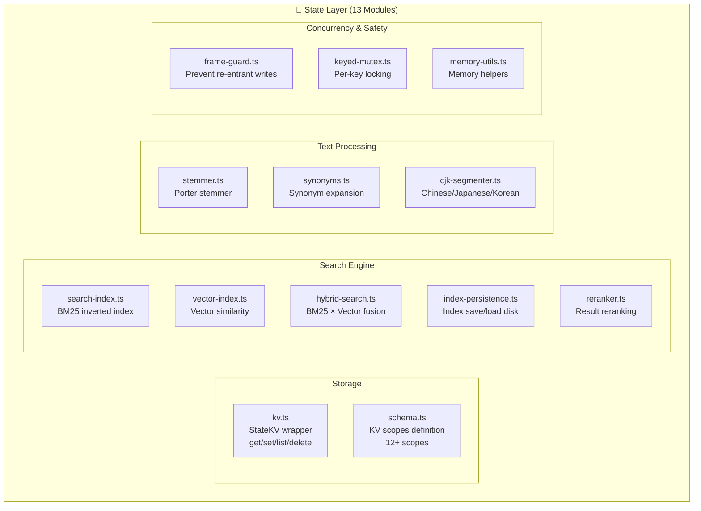

---

## 6. LLM Providers — ۷ ارائه‌دهنده + ۳ لایه Resilience

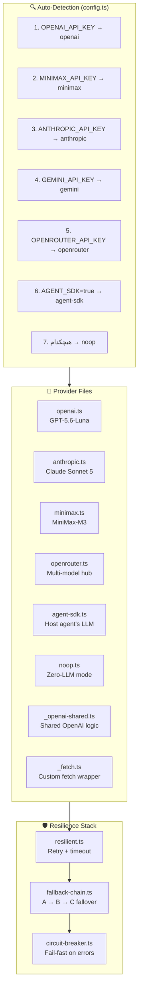

> **نکته**: `gemini` از `OpenRouterProvider` با `baseURL` خاص Google AI Studio استفاده می‌کنه — پس Provider جداگانه نیست.

---

## 7. Embedding Providers — ۷ ارائه‌دهنده

| Provider | فایل | API Key | ابعاد | قابلیت تصویر |
|----------|------|---------|-------|-------------|
| **Gemini** | `embedding/gemini.ts` | `GEMINI_API_KEY` | 768 | ❌ |
| **OpenAI** | `embedding/openai.ts` | `OPENAI_API_KEY` | 1536/3072 | ❌ |
| **Voyage** | `embedding/voyage.ts` | `VOYAGE_API_KEY` | 1024 | ❌ |
| **Cohere** | `embedding/cohere.ts` | `COHERE_API_KEY` | 1024 | ❌ |
| **OpenRouter** | `embedding/openrouter.ts` | `OPENROUTER_API_KEY` | variable | ❌ |
| **Local** | `embedding/local.ts` | — (on-device) | 384 (MiniLM) | ❌ |
| **CLIP** | `embedding/clip.ts` | — (on-device) | 512 | ✅ Image |

**حفاظ ابعاد**: `withDimensionGuard()` — هر embedding رو قبل ذخیره validate می‌کنه. بُعد اشتباه = خطا فوری (نه corrupt شدن ساکت index).

---

## 8. Lifecycle Hooks — ۱۵ هوک + ۱ helper

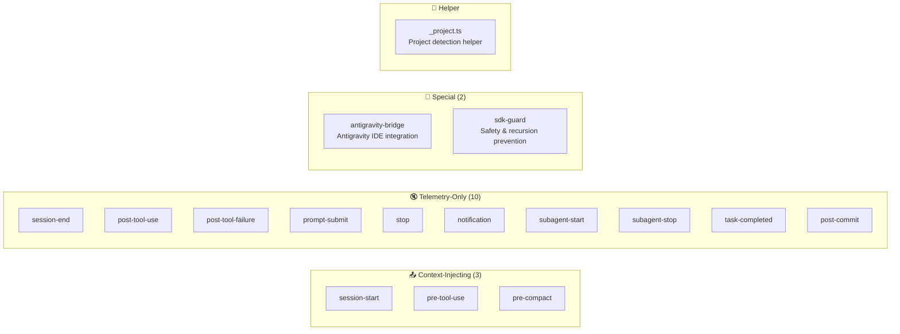

---

## 9. CLI & Connect — ۲۸ ایجنت + ۱۰ CLI Module

### CLI Modules

| ماژول | فایل | وظیفه |
|-------|------|-------|
| Engine Config | `cli/engine-config.ts` | تنظیمات iii-engine |
| Engine Launch | `cli/engine-launch.ts` | راه‌اندازی engine |
| Onboarding | `cli/onboarding.ts` | راه‌اندازی اولیه |
| Doctor | `cli/doctor-diagnostics.ts` | عیب‌یابی |
| Preferences | `cli/preferences.ts` | تنظیمات کاربر |
| Process State | `cli/process-state.ts` | مدیریت فرآیندها |
| Remove Plan | `cli/remove-plan.ts` | حذف نصب |
| Splash | `cli/splash.ts` | صفحه خوش‌آمد |
| Startup Stderr | `cli/startup-stderr.ts` | خطاهای راه‌اندازی |

### ۲۸ Agent Connector

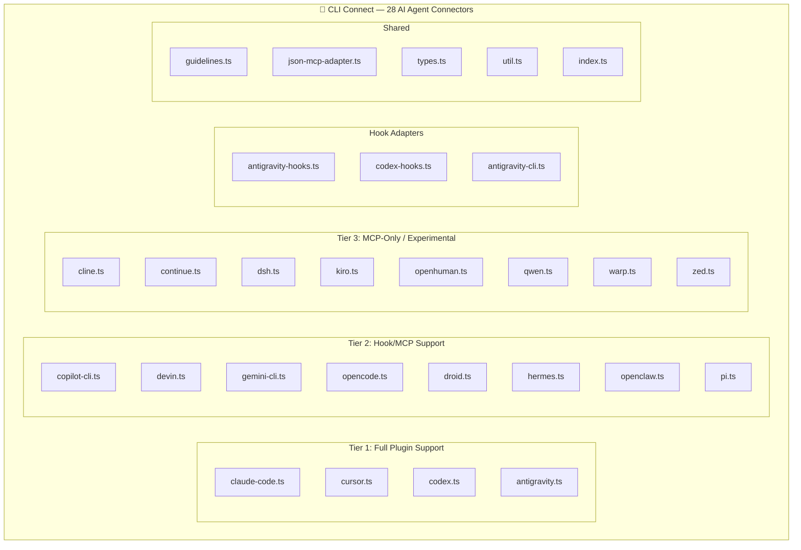

---

## 10. Prompt Templates — ۷ قالب

| Template | فایل | کاربرد | مدل مصرفی |
|----------|------|--------|-----------|
| Compression | `prompts/compression.ts` | فشرده‌سازی خاطرات | LLM Provider |
| Consolidation | `prompts/consolidation.ts` | تلفیق خاطرات | LLM Provider |
| Graph Extraction | `prompts/graph-extraction.ts` | استخراج entity/relation | LLM Provider |
| Reflect | `prompts/reflect.ts` | Self-analysis | LLM Provider |
| Summary | `prompts/summary.ts` | خلاصه‌سازی | LLM Provider |
| Vision | `prompts/vision.ts` | تحلیل تصویری | LLM Provider |
| XML | `prompts/xml.ts` | فرمت XML output | LLM Provider |

---

## 11. Eval / Quality — ۵ ماژول ارزیابی

| ماژول | فایل | وظیفه |
|-------|------|-------|
| Metrics Store | `eval/metrics-store.ts` | ذخیره معیارهای کیفیت |
| Quality | `eval/quality.ts` | سنجش کیفیت خاطرات |
| Schemas | `eval/schemas.ts` | اسکیمای ارزیابی |
| Self-Correct | `eval/self-correct.ts` | تصحیح خودکار خطاها |
| Validator | `eval/validator.ts` | اعتبارسنجی ورودی/خروجی |

---

## 12. Viewer Dashboard — داشبورد وب

| فایل | وظیفه |
|------|-------|
| `viewer/server.ts` | HTTP server (port 3113) |
| `viewer/document.ts` | HTML template generation |
| `viewer/index.html` | SPA shell |
| `viewer/favicon.svg` | آیکون |

> 🌐 `http://localhost:3113` — داشبورد بصری برای مشاهده خاطرات، گراف، timeline

---

## 13. Replay · Health · Telemetry · Utils

| لایه | فایل | وظیفه |
|------|------|-------|
| **Replay** | `replay/jsonl-parser.ts` | پارس فایل‌های JSONL سشن |
| **Replay** | `replay/timeline.ts` | بازسازی timeline سشن |
| **Health** | `health/monitor.ts` | مانیتورینگ سلامت سیستم |
| **Health** | `health/thresholds.ts` | آستانه‌های هشدار |
| **Telemetry** | `telemetry/setup.ts` | راه‌اندازی تله‌متری |
| **Utils** | `utils/image-store.ts` | ذخیره‌سازی تصاویر |

---

## 14. Plugin Ecosystem — ۵۰+ فایل

### ۷ Agent Plugin

| Plugin | دایرکتوری | Hook Config | فایل‌ها |
|--------|----------|-------------|---------|
| **Claude Code** | `plugin/.claude-plugin/` | `hooks/hooks.json` | plugin.json |
| **Codex CLI** | `plugin/.codex-plugin/` | `hooks/hooks.codex.json` | plugin.json |
| **GitHub Copilot** | (root) | `hooks/hooks.copilot.json` | `.mcp.copilot.json` |
| **Cursor** | `plugin/cursor/` | `cursor/hooks.json` | `cursor/mcp.json` |
| **Devin** | `plugin/.devin-plugin/` | `hooks/hooks.devin.json` | plugin.json |
| **OpenCode** | `plugin/opencode/` | — | plugin.json + README |
| **Antigravity** | (hooks) | `hooks/hooks.antigravity.json` | antigravity-bridge hook |
| **Android Droid** | (hooks) | `hooks/hooks.droid.json` | — |

### ۱۷ Plugin Skills

| Skill | دایرکتوری | هدف |
|-------|----------|------|
| `memory-discipline` | `plugin/skills/memory-discipline/` | نظم حافظه |
| `recall` | `plugin/skills/recall/` | فراخوانی خاطره |
| `remember` | `plugin/skills/remember/` | ذخیره خاطره |
| `forget` | `plugin/skills/forget/` | فراموشی هدفمند |
| `lesson` | `plugin/skills/lesson/` | ثبت درس |
| `handoff` | `plugin/skills/handoff/` | تحویل بین سشن |
| `recap` | `plugin/skills/recap/` | خلاصه سشن |
| `commit-context` | `plugin/skills/commit-context/` | زمینه commit |
| `commit-history` | `plugin/skills/commit-history/` | تاریخچه commit |
| `session-history` | `plugin/skills/session-history/` | تاریخچه سشن |
| `agentmemory-architecture` | `plugin/skills/agentmemory-architecture/` | معماری سیستم |
| `agentmemory-mcp-tools` | `plugin/skills/agentmemory-mcp-tools/` | راهنمای MCP |
| `agentmemory-rest-api` | `plugin/skills/agentmemory-rest-api/` | راهنمای REST |
| `agentmemory-hooks` | `plugin/skills/agentmemory-hooks/` | راهنمای هوک‌ها |
| `agentmemory-agents` | `plugin/skills/agentmemory-agents/` | راهنمای ایجنت‌ها |
| `agentmemory-config` | `plugin/skills/agentmemory-config/` | راهنمای تنظیمات |
| `write-agentmemory-skill` | `plugin/skills/write-agentmemory-skill/` | ساخت skill جدید |

### ۴ Integration

| Integration | دایرکتوری | فناوری |
|-------------|----------|--------|
| **Filesystem Watcher** | `integrations/filesystem-watcher/` | Node.js watcher.mjs |
| **Hermes** | `integrations/hermes/` | Python (__init__.py) |
| **OpenClaw** | `integrations/openclaw/` | Node.js plugin.mjs |
| **Pi** | `integrations/pi/` | TypeScript (security.ts) |

---

## 15. Deploy · Benchmark · Docs

### ۴ Deploy Target

| Target | دایرکتوری | فایل‌ها |
|--------|----------|---------|
| **Coolify** | `deploy/coolify/` | Dockerfile + docker-compose.yml + entrypoint.sh |
| **Fly.io** | `deploy/fly/` | Dockerfile + fly.toml + entrypoint.sh |
| **Railway** | `deploy/railway/` | Dockerfile + railway.json + entrypoint.sh |
| **Render** | `deploy/render/` | Dockerfile + render.yaml + entrypoint.sh |

### Docker

| فایل | وظیفه |
|------|-------|
| `docker-compose.yml` | Local Docker setup |
| `iii-config.docker.yaml` | Docker-specific iii config |
| `iii-config.yaml` | Default iii config |

### ۵ Benchmark Suite

| Benchmark | فایل | سنجه |
|-----------|------|------|
| Load 100k | `benchmark/load-100k.ts` | p50/p90/p99 latency |
| LongMemEval | `benchmark/longmemeval-bench.ts` | Recall/precision |
| Quality Eval | `benchmark/quality-eval.ts` | Token savings |
| Scale Eval | `benchmark/scale-eval.ts` | Throughput |
| Real Embeddings | `benchmark/real-embeddings-eval.ts` | Embedding quality |

### مستندات Root

| فایل | محتوا |
|------|-------|
| `README.md` | مستند اصلی |
| `AGENTS.md` | دستورالعمل ایجنت‌ها |
| `DESIGN.md` | طراحی بصری |
| `CHANGELOG.md` | تاریخچه تغییرات |
| `ROADMAP.md` | نقشه راه |
| `CONTRIBUTING.md` | راهنمای مشارکت |
| `GOVERNANCE.md` | حاکمیت پروژه |
| `SECURITY.md` | سیاست امنیتی |
| `MAINTAINERS.md` | نگهدارندگان |
| `CODE_OF_CONDUCT.md` | آداب مشارکت |
| `INSTALL_FOR_AGENTS.md` | راهنمای نصب برای ایجنت‌ها |
| `.env.example` | نمونه متغیرهای محیطی |

---

## 16. Antigravity IDE Tools — نگاشت به لایه‌ها

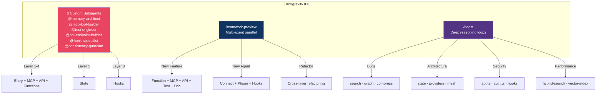

---

## 17. Fable 5.1 Orchestrator

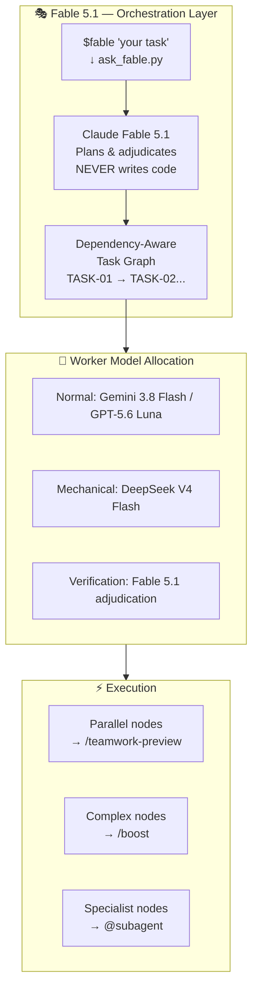

**فراخوانی**:
```bash
$fable Implement temporal decay scoring for agentmemory with MCP tool, REST endpoint, tests, and docs
```

**یا از طریق اسکریپت**:
```bash
python ~/.gemini/config/skills/fable/scripts/ask_fable.py "your objective"
```

---

## 18. Superpowers Framework — ۱۴ مهارت توسعه

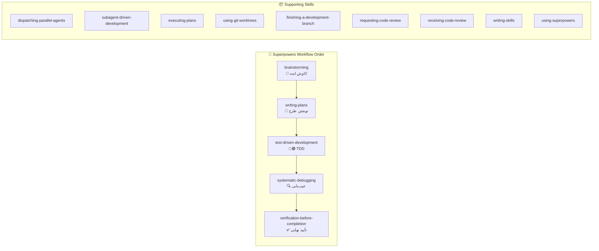

---

## 19. Graphify — گراف دانش کد

| قابلیت | ابزار MCP | کاربرد در agentmemory |
|--------|----------|---------------------|
| `query_graph` | GraphQL-style query | جستجوی روابط بین فایل‌ها |
| `get_node` | Node by ID | جزئیات یک فایل/فانکشن |
| `get_neighbors` | Adjacent nodes | وابستگی‌های مستقیم |
| `get_community` | Community detection | خوشه‌های مرتبط |
| `god_nodes` | Most connected | فایل‌های حیاتی (index.ts, types.ts) |
| `shortest_path` | A → B path | مسیر وابستگی بین دو فایل |
| `graph_stats` | Overview | آمار کل گراف |
| `list_prs` / `get_pr_impact` / `triage_prs` | PR analysis | تحلیل Pull Requests |

---

## 20. Headroom — فشرده‌سازی زمینه

| ابزار | کاربرد |
|-------|--------|
| `headroom_compress` | فشرده‌سازی خروجی ابزارها قبل از LLM |
| `headroom_retrieve` | بازیابی از cache فشرده |
| `headroom_stats` | آمار صرفه‌جویی توکن |

---

## 21. Codeburn — ردیابی هزینه

| ابزار | کاربرد |
|-------|--------|
| `get_usage` | مصرف توکن هر ابزار/مدل |
| `get_savings` | صرفه‌جویی نسبت به baseline |

---

## 22. Consistency Rules — نقشه کامل تأثیر

```mermaid
graph TB
    subgraph CHANGES["🔄 Change Types"]
        CH1["MCP Tool<br/>➕/➖"]
        CH2["REST Endpoint<br/>➕"]
        CH3["Version Bump<br/>⬆️"]
        CH4["KV Scope<br/>➕"]
        CH5["Audit Op<br/>➕"]
        CH6["Hook<br/>➕"]
        CH7["Connect Agent<br/>➕"]
        CH8["Embedding Provider<br/>➕"]
        CH9["LLM Provider<br/>➕"]
        CH10["Prompt Template<br/>➕"]
        CH11["Deploy Target<br/>➕"]
        CH12["Plugin Skill<br/>➕"]
    end

    subgraph FILES["📁 Impacted Files"]
        F1["tools-registry.ts"]
        F2["server.ts"]
        F3["api.ts"]
        F4["index.ts"]
        F5["mcp-standalone.test.ts"]
        F6["README.md"]
        F7["plugin/.claude-plugin/plugin.json"]
        F8["plugin/plugin.json"]
        F9["version.ts"]
        F10["types.ts"]
        F11["export-import.ts"]
        F12["export-import.test.ts"]
        F13["schema.ts"]
        F14["hooks/*.json"]
        F15["cli/connect/index.ts"]
        F16["providers/index.ts"]
        F17["providers/embedding/index.ts"]
        F18["config.ts"]
        F19["prompts/*.ts"]
        F20["deploy/*/Dockerfile"]
        F21["plugin/skills/*/SKILL.md"]
    end

    CH1 -->|"8 files"| F1 & F2 & F3 & F4 & F5 & F6 & F7 & F8
    CH2 -->|"3 files"| F3 & F4 & F6
    CH3 -->|"7 files"| F4 & F7 & F8 & F9 & F10 & F11 & F12
    CH4 -->|"2 files"| F13 & F10
    CH5 -->|"1 file"| F10
    CH6 -->|"3+"| F14 & F4 & F6
    CH7 -->|"2+"| F15 & F6
    CH8 -->|"3+"| F17 & F18 & F6
    CH9 -->|"3+"| F16 & F18 & F6
    CH10 -->|"1+"| F19
    CH11 -->|"4+"| F20 & F6
    CH12 -->|"2+"| F21 & F6
```

---

## 📊 Grand Totals — آمار نهایی

```
╔══════════════════════════════════════════════════════════════╗
║              agentmemory v0.9.29 — COMPLETE INVENTORY       ║
╠══════════════════════════════════════════════════════════════╣
║                                                              ║
║  CORE ENGINE                                                 ║
║  ├── 65 Functions (8 domains)                                ║
║  ├── 260+ iii-engine registrations                           ║
║  ├── 13 State modules                                        ║
║  └── 7 Prompt templates                                      ║
║                                                              ║
║  INTERFACES                                                  ║
║  ├── 54 MCP Tools (8 default, 54 with TOOLS=all)             ║
║  ├── 6 MCP Resources                                         ║
║  ├── 3 MCP Prompts                                           ║
║  ├── 130 REST Endpoints                                      ║
║  └── 15 Lifecycle Hooks (+1 helper)                          ║
║                                                              ║
║  PROVIDERS                                                   ║
║  ├── 7 LLM Providers + 3 resilience layers                   ║
║  ├── 7 Embedding Providers + dimension guard                 ║
║  └── Auto-detection via env vars                             ║
║                                                              ║
║  CLI & CONNECT                                               ║
║  ├── 10 CLI modules                                          ║
║  └── 28 Agent connectors                                     ║
║                                                              ║
║  PLUGINS                                                     ║
║  ├── 7 Agent plugins (Claude/Codex/Copilot/Cursor/Devin/...) ║
║  ├── 17 Plugin skills                                        ║
║  └── 4 External integrations                                 ║
║                                                              ║
║  QUALITY                                                     ║
║  ├── 5 Eval modules                                          ║
║  ├── 2 Replay modules                                        ║
║  ├── 2 Health modules                                        ║
║  ├── 1 Telemetry module                                      ║
║  └── 1 Utils module (image-store)                            ║
║                                                              ║
║  INFRASTRUCTURE                                              ║
║  ├── 1 Viewer dashboard (:3113)                              ║
║  ├── 4 Deploy targets (Coolify/Fly/Railway/Render)           ║
║  ├── 5 Benchmark suites                                      ║
║  ├── 1 Docker compose                                        ║
║  └── 12 Root documentation files                             ║
║                                                              ║
║  TESTING                                                     ║
║  └── 1,596+ vitest tests                                     ║
║                                                              ║
║  ANTIGRAVITY IDE TOOLS                                       ║
║  ├── 6 Custom Subagents                                      ║
║  ├── /teamwork-preview (multi-agent)                         ║
║  ├── /boost (deep reasoning)                                 ║
║  └── $fable (orchestration)                                  ║
║                                                              ║
║  EXTERNAL TOOLS                                              ║
║  ├── Superpowers (14 skills)                                 ║
║  ├── Graphify (code knowledge graph)                         ║
║  ├── Headroom (context compression)                          ║
║  └── Codeburn (cost tracking)                                ║
║                                                              ║
╚══════════════════════════════════════════════════════════════╝
```

---

> [!TIP]
> **نحوه استفاده از این نقشه**:
> 1. **قبل از هر کار** → Fable گراف وظایف بسازه: `$fable your objective`
> 2. **تک‌فایل** → `@subagent` مستقیم
> 3. **چند-فایل** → `/teamwork-preview` با تقسیم بر اساس لایه‌ها
> 4. **باگ سخت** → `/boost` با اشاره به فایل‌ها از جدول §4
> 5. **Consistency** → `@consistency-guardian` + دیاگرام §22
> 6. **Performance** → `/boost` + benchmark §15
> 7. **قبل از commit** → Superpowers `verification-before-completion`
