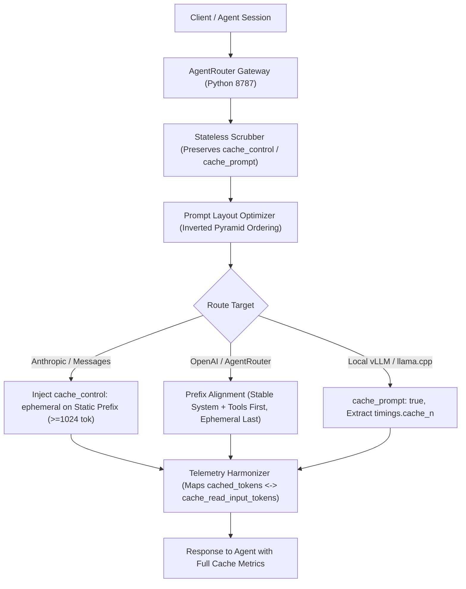

# Prompt Caching Architecture & Seamless Integration Plan

> **Framework:** Harness² Two-Level Recursive Agent Optimization (Propose-Probe-Compose)  
> **Source Concept:** *“Prompt Caching Explained: 3 Minutes to Under 1 Second”* (Sumit Paul — First Principles LLM Inference)  
> **Target Subsystems:** `FastInferenceRouter`, `AgentRouter Gateway`, `MoeInferenceEngine`, and Multi-Agent Harness  
> **Target Consistency Invariant:** 8/3/7-File Atomic Consistency + Zero Side-Effects on existing 1,867 Vitest and 57 Python tests.

---

## 1. Deep-Dive Conceptual & Theoretical Analysis

### 1.1 The Prefill vs. Decode Computational Dichotomy
Large language models operate in two fundamentally different computational phases:
1. **Prefill Phase (Prompt Evaluation):**
   - Given an input sequence $X \in \mathbb{R}^{L \times d}$, every token attends to all prior tokens ($O(L^2)$ complexity).
   - Computes Key and Value projection matrices for all attention layers:
     $$K = X W_K, \quad V = X W_V$$
   - Highly parallel and compute-intensive. On massive prompts (long system instructions, tool definitions, agent memories, or RAG contexts), TTFT (Time To First Token) is substantial: up to **184 seconds on local CPU / 7B model**, and several seconds on busy cloud clusters.
2. **Decode Phase (Autoregressive Generation):**
   - Generates tokens one at a time ($y_1, y_2, \dots$).
   - Bound by memory bandwidth (reading weights and KV tensors from VRAM for each single token step).

### 1.2 The KV Cache & The ~230x TTFT Leap
- If prompt tokens are identical across subsequent requests, their computed $K$ and $V$ tensors can be stored in a **KV Cache**.
- When the server detects an existing prefix match, it **bypasses the entire prefill phase** for those tokens, loading precomputed KV states directly into attention layers.
- **Result from Video Demonstration:** TTFT drops from **184.0s (cold) to 0.8s (warm)** — a **~230x speedup** on a 7B model.
- **Economic Impact:**
  - **Anthropic Claude:** 90% discount on cached input tokens ($0.30/MTok vs $3.00/MTok on Claude Sonnet).
  - **OpenAI:** 50% discount on cached input tokens.
  - **Local Engines (llama-server / vLLM):** Up to 99% reduction in GPU/CPU compute cycles per turn.

### 1.3 Blocks, Fingerprints, Radix Trees, and "The Catch"
Modern inference runtimes (vLLM via PagedAttention/RadixAttention, SGLang, and llama.cpp slot manager) slice prompts into token blocks (e.g., 16 or 32 tokens).
- Each block is identified by a cryptographic/hash fingerprint of its token IDs.
- Block fingerprints are arranged in a **Radix Tree** (prefix tree).
- **The Contiguous Prefix Invariant:** Cache reuse is strictly contiguous starting from token $0$.
- **“The Catch” (Prefix Invalidation):** If **even a single token or character changes early in the prompt** (such as dynamic timestamps, request IDs, nonces, or reordered system rules), the prefix hash diverges at that exact point. **All downstream tokens are invalidated**, forcing a 100% cold re-computation (e.g., 200s latency penalty).

---

## 2. Architectural Blueprint for `marzneshin-agent-os`

To implement Prompt Caching with **zero side effects**, we design a 3-pillar architectural integration:



### Pillar I: The Inverted Pyramid Prompt Cache Ordering Contract
We enforce an architecture-wide contract for prompt structuring across `FastInferenceRouter` and agent harnesses:
1. **Zone 1: Immutable System Core (Static Prefix, >= 1,024 tokens)**  
   - Master prompt instructions, agent identity, safety constraints, coding standards.  
   - **Strict Invariant:** Absolutely NO dynamic timestamps, request IDs, or variable counters in Zone 1.
2. **Zone 2: Deterministic Tools & Action Schemas**  
   - Tool definitions sorted alphabetically by tool name to guarantee byte-for-byte fingerprint stability across turns.
3. **Zone 3: Stable Long-Term Context (Lessons & Reference Artifacts)**  
   - Project memory summaries and settled architecture decisions.
4. **Zone 4: Ephemeral Breakpoint Anchor**  
   - For Anthropic Claude: insert `"cache_control": {"type": "ephemeral"}` at the end of Zone 3 (the exact boundary where static turns to dynamic).
5. **Zone 5: Dynamic Ephemeral Suffix**  
   - Current local timestamp, session nonce, ephemeral working memory, and current user prompt.

### Pillar II: AgentRouter Gateway Cache Bridging & Scrubber Safety (`scripts/agentrouter_gateway.py`)
1. **Preserve Cache Controls in Stateless Scrubbing:**  
   Update `scrub_payload` so it strips dangerous cross-node encryption keys (`previous_response_id`, `reasoning_encrypted_content`) but **strictly preserves** `cache_control` and `cache_prompt`.
2. **Dual-Protocol Cache Translation:**
   - In `translate_anthropic_to_openai`: Extract text from `system` content blocks while preserving block order to preserve prefix cache on OpenAI/vLLM endpoints.
   - In `translate_openai_to_anthropic`: Map OpenAI's `usage.prompt_tokens_details.cached_tokens` to Anthropic's `usage.cache_read_input_tokens` so callers receive accurate caching metrics regardless of backend protocol.
3. **Local Engine Support (`llama.cpp` & `vLLM`):**
   - Automatically pass `"cache_prompt": true` for local / custom endpoints.
   - Parse `timings.cache_n` from `llama-server` responses and surface as `cached_tokens`.
4. **Gateway Telemetry & Health Monitoring:**
   - Expose cumulative prompt cache metrics on `/v1/health` and `/v1/metrics`: total requests, cache hits, cached tokens read, and estimated cost savings.

### Pillar III: FastInferenceRouter & Provider Enhancements (`src/providers/fast-inference.ts`)
1. **`PromptCacheOptimizer` Utility:**
   - Helper class/functions: `buildCacheOptimizedMessages(systemPrompt, userPrompt, options)` and `injectEphemeralBreakpoint()`.
2. **Response Cache Telemetry:**
   - Expand `tokensUsed` in `FastInferenceRouteResponse`:
     ```typescript
     tokensUsed?: {
       prompt: number;
       completion: number;
       total: number;
       cachedTokens?: number;
       cacheCreationTokens?: number;
       cacheHitRatio?: number;
     }
     ```
3. **Local Channel Default Optimization:**
   - Set `"cache_prompt": true` on `local-vllm-channel` and any custom endpoints.

---

## 3. Harness² Recursive Optimization (Dual Candidates: C_inv vs C_dom)

Following the Google Research Harness² Two-Level Recursive Agent Optimization standard (`harness2-recursion`):

```
Level 1: Task-Level Recursion (Propose -> Probe -> Compose)
┌─────────────────────────────────────────────────────────────┐
│ Candidate C_inv (Invariant Mutation):                       │
│ - Zero modification to API signatures or schema types       │
│ - Strict backwards compatibility for all optional fields    │
│ - Preserves 8/3/7-file consistency contracts                │
├─────────────────────────────────────────────────────────────┤
│ Candidate C_dom (Domain Mutation):                          │
│ - Add prompt cache block ordering and breakpoint tagging    │
│ - Bridge OpenAI cached_tokens <-> Anthropic cache_read      │
│ - Support llama.cpp timings.cache_n in usage telemetries    │
├─────────────────────────────────────────────────────────────┤
│ Contrastive Composition:                                    │
│ Compose C_inv + C_dom into non-breaking, opt-in enhancements│
└─────────────────────────────────────────────────────────────┘
```

---

## 4. Step-by-Step Implementation Tasks

### Task 1: Prompt Cache Ordering & Optimizer in TypeScript Core
- **Files to Modify:** `src/providers/fast-inference.ts`, `src/types.ts`
- **Actions:**
  1. Add optional prompt cache telemetry fields to `FastInferenceRouteResponse` and `FastInferenceChannel`.
  2. Implement `PromptCacheOptimizer` with deterministic zone layout (Static System -> Sorted Tools -> Stable Memories -> Breakpoint -> Dynamic User/Time).
  3. Update `defaultHttpInvoker` to parse `prompt_tokens_details.cached_tokens`, `cache_read_input_tokens`, and `timings.cache_n`.
  4. Ensure `"cache_prompt": true` is passed for local/vLLM endpoints.
- **Verification:** Run `npx vitest run test/fast-inference-router.test.ts`.

### Task 2: AgentRouter Gateway Protocol Bridging & Telemetry
- **Files to Modify:** `scripts/agentrouter_gateway.py`
- **Actions:**
  1. Update `scrub_payload` to preserve `cache_control` blocks in system/messages.
  2. Enhance `translate_anthropic_to_openai` and `translate_openai_to_anthropic` to bi-directionally map cached token counts.
  3. Support `cache_prompt: true` forwarding and `timings.cache_n` extraction.
  4. Expose `cache_metrics` in `/v1/health` response.
- **Verification:** Run `python -m unittest test/python/test_agentrouter_mesh.py`.

### Task 3: Comprehensive Unit & Integration Tests (TDD)
- **New Test Files:**
  1. `test/prompt-caching.test.ts` (Vitest suite testing prefix alignment, breakpoint injection, and token extraction).
  2. `test/python/test_prompt_caching_gateway.py` (Python test suite verifying gateway cache bridging, header forwarding, and telemetry mapping).
- **Verification:** Run `npm test` and `python -m unittest discover test/python`.

### Task 4: Harness² Experience Persistence
- **Files to Update:** `state/EXPERIENCE.md`, `state/LEDGER.json`
- **Actions:**
  Record the prompt caching optimization patterns, prefix sensitivity invariants, and benchmark measurements into the Experience Ledger using `python scripts/harness2.py record-experience`.

---

## 5. Verification & Acceptance Criteria
1. **Existing Test Suite:** All 1,867 Vitest tests and 57 Python tests continue to pass without error (`npm test` & `python -m unittest discover test/python`).
2. **Atomic Consistency:** `python scripts/harness2.py verify-sync` returns `"atomic_sync": "PASS"`.
3. **Cache Telemetry Integrity:** Gateway and FastInferenceRouter accurately report `cached_tokens` and calculate `cacheHitRatio` on simulated cached responses.
4. **Prefix Stability:** Zone 1 static system prompt remains identical across turns, preventing cache invalidation.
